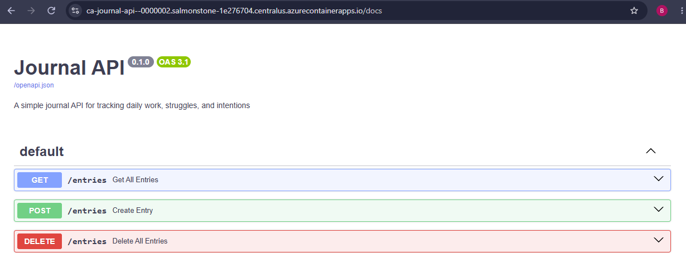
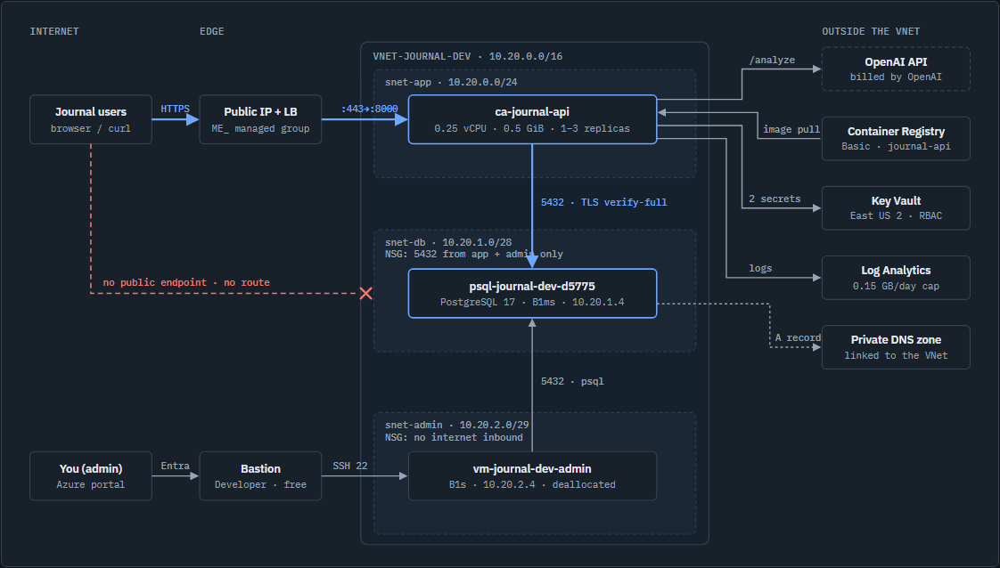
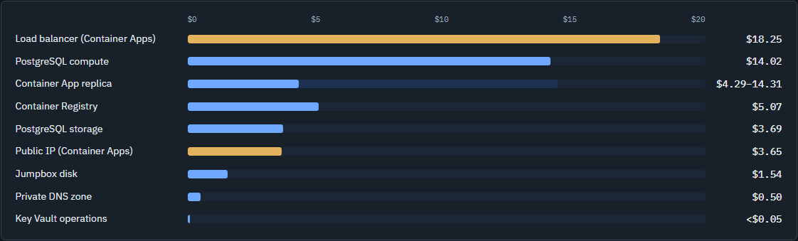

# Learn to Cloud Phase 3 & 4 Capstone: Journal API

## Phase 4 Capstone: Deploy Journal App in Cloud (Azure)
### Overview
Phase 4 of the Learn to Cloud Journal project required the app created in Phase 3 to be deployed in the cloud. For my instance, I used **Microsoft Azure**.

The work completed in this phase was completed inside the **/infra** folder. **Claude Code** was used to walk through the individual steps required to migrate this project from a local setup to a cloud hosted application.

Each script in the folder is used to implement the final project. The **README.MD** file in the **/infra** folder serves as a walkthrough of the steps needed to successfully deploy the application. Once each script is executed, there are validation steps that are performed manually to ensure that the step’s required work was completed successfully. 

On top of that, there is a **Azure Portal version** of this project that I walked through to further grasp what was being deployed in Azure.

The steps (script files and portal) are as follows:

0.	**Budgeting** – Creates budget for project
1.	**Network foundation** – Creates Vnet, NSGs, subnets, and private DNS zone
2.	**Secrets** – Creates Key Vault for secrets
3.	**Database** – Sets up PostgreSQL 16 Flexible server
4.	**Admin** and Remote Jumpbox – Establishes Jumpbox connection to install PostgreSQL and role on VM.
5.	**Container** Registry – Creates container registry.
6.	**Container** App – Deploys container application and verifies that applications functions the same in the cloud, as it does locally.
7.	**Teardown** – Once validated, resources were deprovisioned to avoid excess cost.

### Architecture

The blue path is a user request. The database has no public address, so the internet path ends at the VNet edge. Administration comes in through Bastion after an Entra sign-in. The app reads only two Key Vault secrets (database-url and openai-api-key) and pulls its image with its managed identity. No password is stored in its configuration.
### Resource and Cost Breakdown

| Resource | Configuration | Unit price | Per month |
| --- | --- | --- | --- |
| App tier |  |  |  |
| ca-journal-api | 0.25 vCPU, 0.5 GiB, 1 replica always onAfter the monthly free grant of 180,000 vCPU-s and 360,000 GiB-s. The first 2M requests are free. | $0.000003–0.000024/vCPU-s $0.000003/GiB-s | $4.29–14.31 |
| capp-svc-lb | Standard load balancer, 2 rulesCreated in the ME\_ group because the environment uses your VNet | $0.025/hour + $0.005/GB | $18.25 |
| capp-svc-lb-ip | Standard static public IP for ingress | $0.005/hour | $3.65 |
| acrjournaldevd5775 | Basic registry, 57 MB of 10 GB used | $0.1666/day | $5.07 |
| Database tier |  |  |  |
| psql-journal-dev-d5775 | Burstable B1ms, 1 vCore, 2 GiB | $0.01921/hour | $14.02 |
| Storage | 32 GB, autogrow off7-day backups are free up to 100% of provisioned storage | $0.115/GB-month | $3.69 |
| Admin tier |  |  |  |
| vm-journal-dev-admin | B1s, deallocated$9.13/month if left running; it shuts itself down at 06:00 UTC | $0.0125/hour running | $0.00 |
| OS disk | 30 GB Standard HDD (S4) | $1.536/month | $1.54 |
| bas-journal-dev | Bastion Developer, one session at a time | free | $0.00 |
| Shared services |  |  |  |
| journal-dev.private.postgres… | Private DNS zone, 1 record, VNet link | $0.50/zone | $0.50 |
| kv-journal-dev-d5775 | Standard vault, 5 secretsThe app re-reads its two secrets every 30 minutes, about 3,000 operations a month | $0.03/10K operations | \<$0.05 |
| log-journal-dev | 30-day retention, 0.15 GB/day capThe cap keeps ingestion under the 5 GB monthly free allowance | $2.76/GB after 5 GB | $0.00 |
| Free | VNet and subnets, 3 NSGs, managed identity, budget, auto-shutdown schedule, provider registrations | — | $0.00 |
| Total, before OpenAI usage (billed separately by OpenAI) | $51.06–61.08 |  |  |

### Areas for Improvement
The project was completed with the assistance of Claude Code. The steps completed aimed to educate along the creation of the scripts used. Additionally, I went through the deployment a second time using the portal to validate what was completed.

On a different iteration of this, finding solutions and areas of improvement on my own would be one way to improve on the knowledge gained completing this project.

## Phase 3 Capstone: Journal Application Local Deployment

Welcome to [Learn to Cloud's](https://learntocloud.com) Phase 3 capstone. You will be guided to building a journal API with **FastAPI**, **PostgreSQL**, structured logging, input validation, and AI-powered entry analysis.

### Capstone

These chapters will guide you and are meant to be completed in order. Each chapter builds on the previous one, so do not skip ahead. 

1. [Check the prerequisites](docs/01-prerequisites.md)
2. [Set up the project](docs/02-project-setup.md)
3. [Run the API](docs/03-run-the-api.md)
4. [Build GET for one entry](docs/04-get-entry.md)
5. [Build DELETE for one entry](docs/05-delete-entry.md)
6. [Add input validation and debug a partial update](docs/06-input-validation.md)
7. [Use logs to understand the API](docs/07-logging.md)
8. [Set up an AI provider](docs/08-ai-setup.md)
9. [Build AI-powered analysis](docs/09-ai-analysis.md)
10. [Finish the capstone](docs/10-finish.md)

**[Start the capstone →](docs/01-prerequisites.md)**

### Reference

This is additional reference material for the capstone in case you want to explore further or need help:

- [Testing and CI](docs/reference/testing-and-ci.md)
- [Troubleshooting](docs/reference/troubleshooting.md)
- [Sync your fork with upstream](docs/reference/upstream-sync.md)
- [Explore your database](docs/reference/explore-database.md)

> **Learning environment only:** This application has no authentication or
> per-user data isolation. Do not expose it publicly or store personal or
> sensitive journal content in it.

### License

MIT License - see [LICENSE](LICENSE).
